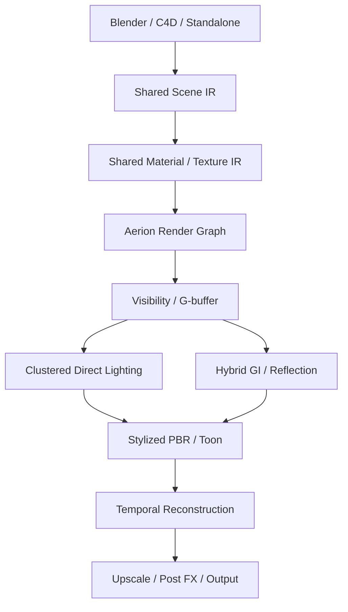
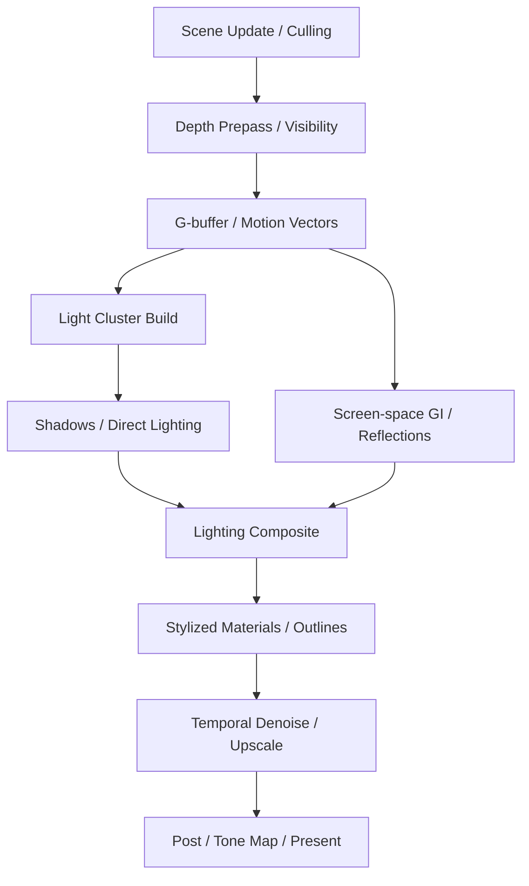

# Aerion — Real-Time Hybrid Rendering Engine 設計書

**Version:** 0.1（構想・アーキテクチャ設計）  
**作成日:** 2026-11-04  
**位置づけ:** Verion（高品質GPUパストレーサー）と対になるリアルタイムレンダラー。Blender/Cinema 4Dのビューポート・IPR、および将来の独立アプリで利用する。

> 本書のGPU時間は目標上の仮配分であり、実測値ではない。各APIの可用性と性能はOS、GPU世代、ドライバに依存する。

## 1. コンセプト

**Aerion = Real-Time Hybrid Rendering Engine.** 「物理的な光の説得力と、アーティストが意図したスタイルを、リアルタイムに」。Rasterizationを中心にし、必要な場所だけHardware Ray Tracingとキャッシュ・再構成技術を使う。

### Verionとの棲み分け

| 領域 | Verion | Aerion |
|---|---|---|
| 主目的 | 最終画像・収束品質 | 操作への応答性・連続描画 |
| 主な手法 | GPU Path Tracing | Raster + Hybrid RT |
| GI | 高品質Path Tracing、ReSTIR、NRC | Surface Cache、Screen-space、選択的RT |
| Sampling | 画質へ収束するまで積算 | 固定Frame Budget内で少量のサンプル |
| Temporal | アニメーション品質と再利用 | 履歴再投影・Denoise・Upscalingが中核 |
| Materials | 共通のPBR / Toon / Stylized IR | 同じIRからリアルタイム実装へ変換 |
| 品質保証 | Reference/Productionモード | 高速プレビューとの見た目差を可視化 |

**初期性能目標:** 1080p、60 FPS（1フレーム約16.67ms）をターゲットとする。ただし対象GPU・シーンを指定して初めて検証可能な目標であり、すべてのハードウェアで保証しない。重いシーンでは30 FPS/Progressiveへ切り替える。

## 2. 全体アーキテクチャ



### 分割するCrate / Module

| Module | 責務 |
|---|---|
| `aerion-core` | Frame制御、Quality Profile、Capabilities |
| `aerion-visibility` | Raster Pipeline、Depth、G-buffer、Object ID |
| `aerion-lighting` | Clustered Lights、Shadow Maps、Direct Lighting |
| `aerion-gi` | Screen-space GI、Radiance Surface Cache、RT補完 |
| `aerion-reflections` | SSRとRay Tracing Fallback |
| `aerion-stylization` | Toon Ramp、Face Shading、Hair、Outline、GI Stylization |
| `aerion-temporal` | Motion/History/Reprojection、History Validation |
| `aerion-reconstruction` | Denoise、Upscale、AA |
| `aerion-scheduler` | Frame Time Controller、Quality Scaling |
| `aerion-vulkan` / `aerion-metal` | API固有のResource、Barrier、Shader、RT |

これは論理分割であり、各Crateを細分化しすぎる前に最初のプロトタイプで境界を検証する。

## 3. Verionと共有するもの・共有しないもの

### 共有する意味論

- Scene IR：Mesh、Instance、Camera、Light、Animation、Transform、Geometry Revision。
- Material Graph / Stylization：PBR BSDFパラメータ、Roughness、Metallic、Toon Ramp、Face/Outline設定。
- Texture Package、Mipmap生成、色空間、アセットID、依存関係・キャッシュキー。
- GPU Backendの能力検出、Resource命名、Render Graph概念、計測指標。
- AOV名、EXR、OCIO、色管理、Motion Vectorの座標規約。

### 別実装にするもの

- VerionのWavefront IntegratorとAerionのRaster/Visibility。
- VerionのReference LightingとAerionのScreen-space / Cache GI。
- Frame Budgetに合わせたAerion専用Denoising/History。
- VulkanとMetalのGPUリソース、同期、Shader Binary、Sparse Resource処理。

共通化は「同じ絵を目指すためのデータ契約」を中心にする。処理パイプラインを無理に共通化しない。

## 4. 1フレームのRender Graph



必要に応じてRT PassはDepth/G-bufferの後に実行し、Surface Cacheを参照する。ComputeとGraphics Queueの非同期実行は依存関係と実機計測に基づいて有効にする。

### 必須AOV・バッファ

- Depth、Linear Depth、World/View Normal、Albedo、Roughness、Metallic。
- Material ID、Object ID、Motion Vector、Emission、Shadow Mask。
- Direct/Indirect Diffuse、Specular、Reflection Confidence、GI Confidence。
- Style Edge / Face Shadow Mask、Reactive Mask、History Validity。

## 5. Visibilityと直接照明

### Rasterization

初期はForward+またはDeferredを比較し、**G-bufferベースのDeferred + Hybrid RT**を主案とする。透明材質・髪・ボリュームは専用Forward Passが必要になる可能性がある。

- Frustum Culling、GPU Occlusion Culling、Instance Batching。
- Depth Prepassはシーン次第で有効/無効を比較。
- Meshlet/Mesh Shaderを将来候補にするが、機能未対応GPUへFallbackを用意。
- G-bufferの帯域を抑えるためNormal圧縮、必要最小限のフォーマット設計。

### Direct Lighting

- Clustered/Tiled Light Cullingで各画素に関連する光源を整理。
- 基本Shadow Maps（Directional Cascade、Spot、Point）を実装。
- 接触影・精密な遮蔽には対応デバイスでVulkan Ray Query/Metal RTを追加。
- 多数の小光源ではReSTIR DIをオプションとして評価。少数ライトでは通常のClustered Lightingが速い場合もある。[S1]

## 6. Hybrid Global Illumination

**構成:** Screen-space GI → Surface Radiance Cache → 選択的Ray Tracingという段階的な補完。Scene Revisionでキャッシュ無効化を制御する。

### 6.1 Screen-space GI

Depth/Normal/G-bufferに基づく高速なGI近似。ただし画面外の情報や遮蔽裏の情報が不足する。空間的・時間的フィルタリングが必要。

### 6.2 Surface Radiance Cache

シーン表面に紐づくLightingを低頻度で更新し、複数ピクセル・フレームで使い回す。Unreal EngineのLumenがSurface Cacheを利用する考え方は参考になる。[S2]

初期候補：World-space Probe/Surfel、Mesh/Surface Card表現などを比較。Cache KeyはGeometry、Material、Light Revisionを含み、近傍点の再利用ではNormal/Material/Visibilityを確認。

### 6.3 RT補完

Screen-spaceで見えない光路や高品質モードの照明を、少数のHardware Rayで補完する。全画素で複数Bounceを毎フレーム追跡する設計を避ける。

### 6.4 ReSTIR GI / Neural GI

将来の実験対象。リアルタイムで常に有利とは限らず、Reservoirのメモリ・再サンプリング、Neural推論・学習コストを含めて評価する。[S3]

## 7. Hybrid Reflections

1. Screen-space Reflectionsで低コストの候補を得る。
2. 画面外・失敗・信頼度不足の箇所はRT Fallback。
3. Roughnessが大きい反射は低解像度・Radiance Cacheを優先。
4. Mirror/Low Roughnessは精度重視のRT経路へ。
5. Temporal ValidationとDenoisingを適用。

SSRとRTを切り替える境界が見えたり、履歴が汚染される問題をテストする。重要な反射はユーザー指定で品質を固定できるようにする。

## 8. Stylized PBR / Toonはコア機能

AerionはToonを「軽量なポストエフェクト」に閉じ込めない。VerionとのMaterial IR共有を最初から設計する。

| 機能 | Aerion実装候補 | 注意点 |
|---|---|---|
| HybridSurface | PBR成分とToon成分をLight/Material単位で混合 | Verionとの意味論一致 |
| Toon Ramp | 影の段階化・Feather・色パレット | TAAで境界が滲まないようにする |
| Face Shadow | SDF/Control Map + Light Direction | 視点・表情変化時の整合性 |
| Hair Highlights | Anisotropic + Shape Modulation | 帯状・細線のAnti-aliasing |
| Outline | Geometry/Depth/Normal/IDベース | 内部解像度と表示解像度の使い分け |
| Artistic GI | キャッシュGIの色・強度を段階制御 | 物理GIとは別パラメータとして表示 |

**推奨:** Stylization前のLighting AOVと、Stylization後のBeautyを別管理。アップスケーラが境界を消す場合、特定OutlineやUI向けラインを出力解像度で描画する。

Unity Shader GraphのCustom Lightingや、PBR/NPRを統合する研究はShading設計の参考。[S4][S5]

## 9. Temporal Reconstruction / Upscaling

リアルタイム性の最重要要素の一つ。履歴を再投影し、少ないサンプルの光・反射を安定化する。

### 必須の履歴検証

- Motion VectorとJitter規約の一貫性。
- Depth、Normal、Object/Material IDの不一致時に履歴破棄。
- Disocclusion、カメラカット、ライト変更、透明オブジェクトを検知。
- ReSTIR Reservoir、GI Cache、Denoiser、Upscalerの履歴が別々の有効性を持つことを認識。
- GhostingとToon ShadowのEdge Smearingを評価。

### バックエンド別のReconstruction候補

- Vulkan汎用：FSR Temporal Upscaling等を調査。FSRは前後フレームのデータを利用する。[S6]
- Apple Silicon：MetalFX Denoising/Upscalingを利用可能なGPU・OSで調査。[S7]
- NVIDIA：専用のNeural Reconstructionを追加検討。ただしライセンス・対応GPU・SDK要件を確認。

Frame Generationは表示FPSを増やせても操作応答性や内部シミュレーション/レンダリング時間を同じ比率で改善するわけではない。DCC用IPRではまず実フレーム生成速度を優先する。

## 10. Frame BudgetとAdaptive Quality Scheduler

60 FPSに必要な理論的フレーム予算：\(1000/60 \simeq 16.67\,\mathrm{ms}\)。以下は**仮配分**。

| Pass | 仮GPU予算 |
|---|---:|
| Visibility / G-buffer | 2.0ms |
| Direct Light / Shadow | 3.0ms |
| GI / Reflections | 4.0ms |
| Stylized Shading | 1.5ms |
| Temporal Reconstruction / Upscale | 3.0ms |
| Post / Composite | 1.0ms |
| 余裕・変動分 | 2.17ms |
| **合計** | **16.67ms** |

CPU負荷・フレーム待機・Presentも体感レイテンシに影響する。GPU Passの合計だけで60 FPSが保証されるわけではない。

### Quality Controller

```rust
struct FrameQualityState {
    render_scale: f32,
    rt_ray_budget: u32,
    gi_update_budget: u32,
    reflection_quality: u8,
    shadow_quality: u8,
    temporal_history_strength: f32,
}
```

- GPU時間超過：まず低優先のRT/GI更新を減らす。次にRender ScaleやShadow解像度を調整。
- GPU余裕：GI Cache更新、Reflection品質、Render Scaleを徐々に増やす。
- Toon顔・輪郭・重要被写体：低品質化の対象から可能な限り保護。
- Dynamic Resolution変更時はHistory ValidationとReprojectionに対応。
- 急激な品質振動を避けるため、Hysteresis、移動平均、最小更新間隔を使う。

### 2つの動作モード

| モード | 動作 | 品質方針 |
|---|---|---|
| Realtime | フレーム予算を守るよう適応調整 | 操作レスポンス優先 |
| Progressive | カメラ停止時に蓄積・更新を増やす | 静止画のプレビュー品質優先 |

操作停止時は画面の変化が小さくなるが、ライト・アニメーションやシミュレーションが進行中なら履歴の妥当性を継続検証する。

## 11. GPUバックエンド・メモリ管理

### Vulkan

- Rasterization/Computeを基本に、`VK_KHR_ray_query`やRT PipelineはCapabilitiesで有効化。
- G-bufferとTexture StreamingをGPUメモリ予算に収める。
- 必要なリソースバリア、Queue Ownership、TimingをRender Graphが管理。
- ShaderはSlangを候補とし、SPIR-V生成を中心にする。

### Metal

- ネイティブMetal Rasterization/Compute、対応機能でHardware RT。
- MetalFX Upscale/Denoiseを検証。[S7]
- GPU世代でRTとNeural機能が異なるためCapabilityごとにFallback。

### 共通のMemory Policy

Verion用に設計したTexture Preprocess/Mipmap/Cache Keysを再利用する。ただしGPU Resident Bufferや同期はBackend別。AerionはG-buffer、History、Surface Cacheの固定メモリ負担が大きいため、VRAMが足りない場合はCache容量・解像度を段階的に調整。

## 12. IPR / DCC連携

- BlenderのRenderEngineアダプタとC4DプラグインからScene Revision差分を受信。
- Camera/Material/Light/Geometry Changeを分類し、必要なGPUリソースだけ更新。
- Material編集時に不要なBLAS再構築を避ける。
- Verionへ切り替える際に、Scene IR・Materialパラメータ・Texture Cacheキーを共有。
- Preview/FInalで差が出る機能にはVisual WarningまたはAOV比較を提供。

**制作フロー:** Aerionでライティング・Stylized Lookを対話的に調整 → Verionで最終画像をレンダリング → 必要ならAI Video Bridgeで演出拡張。

## 13. 性能・画質検証

### 計測指標

- Frame Timeの平均、P95、P99（CPU/GPU別）。
- Camera操作から表示反映までのレイテンシ。
- G-buffer、Shadow、GI、RT、Denoise、Upscale各PassのGPU時間。
- VRAM Peak、Surface Cache Hit Rate、History Rejection Rate。
- Verion Referenceとの画像差（同一Material/Light条件）。
- Temporal Flicker、Ghosting、SSR破綻、Toon Boundaryの滲み。

### 代表テストシーン

1. 多数のライトがある室内。
2. 屋外の広い環境と動的な太陽。
3. 鏡・ガラス・金属が多いスタジオ。
4. 動的オブジェクトとGI。
5. アニメキャラクターの顔・髪・Toon Shadow・Outline。
6. 高解像度Texture、大量Instance、カメラ高速移動。
7. カメラカット・Disocclusion・透明材質によるHistory破綻。

**品質比較:** 固定解像度Native、Upscaling有効、RT有効/無効、Cache有効/無効でA/B測定し、FPSだけでなくフリッカーや顔影の破綻を観察する。

## 14. 開発ロードマップ

| Phase | 実装 | 完了条件 |
|---|---|---|
| M0 | Window/Swapchain、GPU Timestamp、Render Graph | 空Sceneの描画・Pass計測 |
| M1 | Rasterizer、Depth/G-buffer、PBR、Texture | 3D Sceneを安定描画 |
| M2 | Clustered Lighting、Shadow Maps | 多光源と主要Shadow |
| M3 | HybridSurface、Toon Ramp、Face/Hair/Outlineの基礎 | Verion共通Materialの主要ルックを表示 |
| M4 | Motion Vector、TAA/Temporal Upscale | 動くCameraで安定した1080p出力 |
| M5 | SSR / Screen-space GI | 高速な反射と限定GI |
| M6 | Vulkan RT、RT Reflection/Shadow Fallback | 画面外反射・遮蔽を補完 |
| M7 | Surface Radiance Cache、Scene-aware更新 | GI品質とFrame Budgetの改善 |
| M8 | ReSTIR DI、Adaptive Quality Scheduler | 多光源性能、Frame Time安定化 |
| M9 | Metal Backend、MetalFX | Apple Siliconで基本機能を再現 |
| M10 | DCC IPR統合、Progressive Preview | 編集→描画→最終Verion切替 |
| Research | Neural GI / ReSTIR GI / 高度なTemporal Reconstruction | 実測で利益がある機能のみ採用 |

**MVPの範囲:** M0〜M3。最初から60FPSと高度なGIを両立させようとせず、固定Scene/GPUに対してPBR・Toon・Shadowを計測する。

## 15. リスク・未決事項

1. **Verionとの完全なルック一致は難しい。** GIや反射手法が異なるため、許容差と比較AOVを定義する。
2. **Temporal Historyの汚染。** 反射・透明・Toon境界でGhosting/Smearingが発生しやすい。
3. **Surface Cacheの不一致。** 動的な材質・遮蔽・ライト更新時に古いGIが残る。
4. **Adaptive Qualityの振動。** Frame Timeが変動した際に品質が目立って上下し得る。
5. **Metal/Vulkanの機能差。** 同じShaderとRT方式を完全共有できない。
6. **高機能化によるVRAM圧迫。** G-buffer、History、GI Cache、Shadow、Texture Cacheを同時保持。
7. **DCCへの組み込み。** ビューポートAPI、RenderEngine、C4Dプラグインで表示経路と制約が異なる。
8. **Frame Generationへの過信。** 表示FPSと実際の操作遅延は別指標。

## 16. 参考資料

公式SDK、エンジン資料、研究・技術文書を中心に記載。実装時は最新版とライセンスを再確認する。

- **[S1] NVIDIA RTXDI — Integration:** https://github.com/NVIDIA-RTX/RTXDI/blob/main/Doc/Integration.md
- **[S2] Unreal Engine — Lumen Technical Details:** https://dev.epicgames.com/documentation/unreal-engine/lumen-technical-details-in-unreal-engine
- **[S3] NVIDIA RTXDI — ReSTIR GI:** https://github.com/NVIDIA-RTX/RTXDI/blob/main/Doc/RestirGI.md
- **[S4] Unity Shader Graph — Custom Lighting Components:** https://github.com/Unity-Technologies/Graphics/blob/master/Packages/com.unity.shadergraph/Documentation~/Shader-Graph-Sample-Custom-Lighting-Components.md
- **[S5] Stylized Rendering as a Function of Expectation (ACM TOG):** https://doi.org/10.1145/3658161
- **[S6] AMD FidelityFX — Temporal Upscaler:** https://gpuopen.com/manuals/fidelityfx_sdk/techniques/super-resolution-upscaler/
- **[S7] Apple WWDC25 — Metal 4 / MetalFX:** https://developer.apple.com/videos/play/wwdc2025/211/
- **[S8] Khronos — Vulkan Ray Tracing:** https://docs.vulkan.org/guide/latest/extensions/ray_tracing.html
- **[S9] Khronos — Ray Query Tutorial:** https://github.khronos.org/Vulkan-Site/tutorial/latest/Building_a_Simple_Engine/Advanced_Topics/Ray_Query_Rendering.html
- **[S10] Epic Games — Lumen GI and Reflections:** https://dev.epicgames.com/documentation/unreal-engine/lumen-global-illumination-and-reflections-in-unreal-engine
- **[S11] AMD FidelityFX — FSR3:** https://gpuopen.com/fidelityfx-super-resolution-3/
- **[S12] Apple WWDC26 — Neural Rendering with Metal:** https://developer.apple.com/videos/play/wwdc2026/359/

## 17. 次の具体的設計タスク

1. `AerionFrameGraph`のPass DAGとGPU同期・Resource Lifetime。
2. G-buffer FormatとTexture/Material ID、Motion Vector規約。
3. Clustered LightingのCluster形状、Light Culling、Shadow Atlas。
4. Surface Cacheのデータ表現とScene Revision依存。
5. Adaptive Quality Schedulerの目標Frame Timeと制御ポリシー。
6. VerionとのHybridSurface IRと近似ルール。
7. Vulkan/Metal Feature Matrix、Fallback、Render Test Suite。

