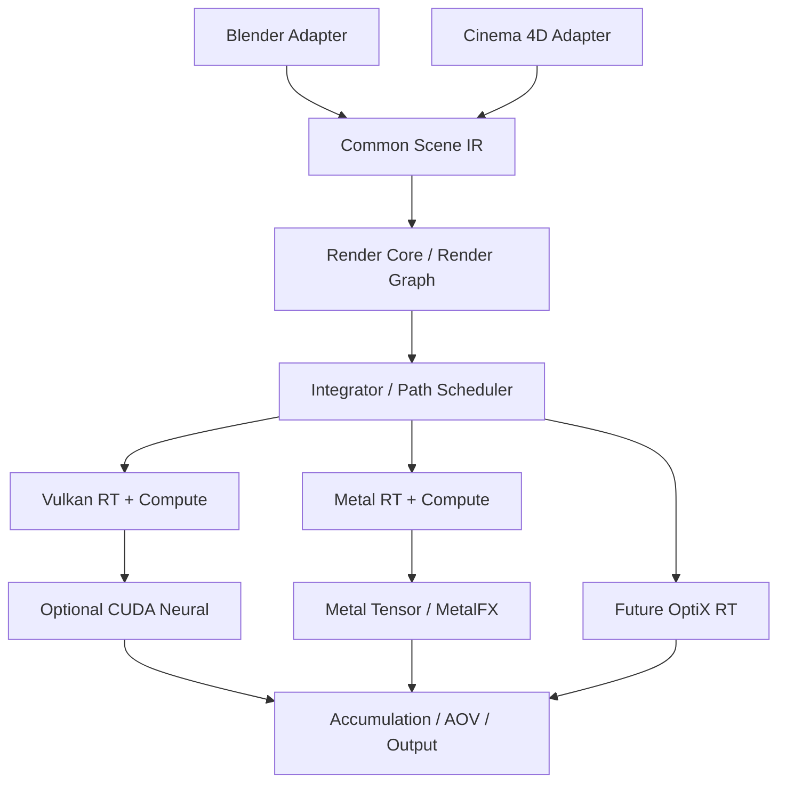
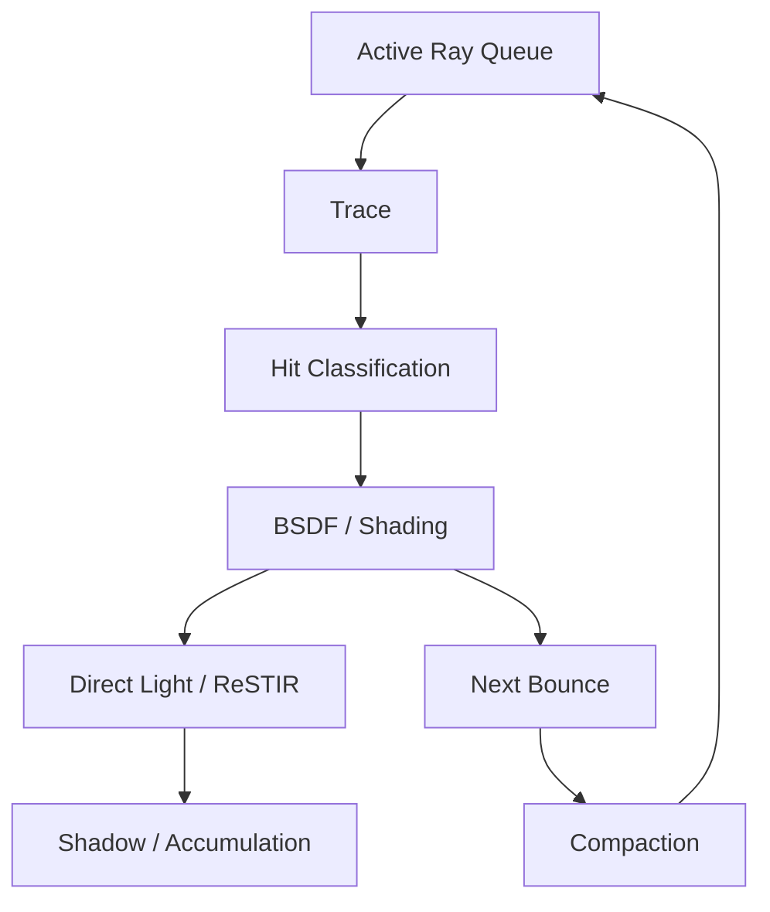

# Hybrid GPU Renderer — 技術構想・アーキテクチャ設計書

**Version:** 0.2 (構想段階)  
**更新日:** 2026-11-04  
**目的:** Blender / Cinema 4D から使える、物理レンダリング・AI高速化・Stylized PBR / Hybrid NPRを統合したGPUレンダラー。Octane Renderを性能比較対象とし、同等画質までの時間、IPR応答性、アニメーション総レンダリング時間の短縮を狙う。同時に、写実から現代的なAAAゲーム風のスタイライズ表現、セルルックまでをアーティストが制御できることを**コア要件**とする。

> 本書は設計案であり、実装済みの機能や性能を示すものではない。研究上の仮説と確認済みのAPI・技術を区別する。

## 1. 決定した基本方針

- **レンダラー本体:** Rust。DCCに依存しない共通Render Core。
- **DCC対応:** Blenderを先行し、Cinema 4Dを後から追加。それぞれ薄い連携プラグインを作る。
- **GPU共通基盤:** Vulkan Ray Tracing + Compute。
- **NVIDIA高速パス:** 共通Vulkan RTを使いつつ、CUDA / Tensor Coreでニューラル学習・推論を加速。将来、OptiX RTも比較・追加可能にする。
- **Apple Silicon:** ネイティブMetalバックエンドを用意。M3以降を高速RTの主対象、M1/M2は機能制限付き互換モードの候補とする。実際の対応表は機能検出で決める。
- **品質方針:** Interactive / Production / Referenceの3モード。AI近似なしの物理レンダリング経路を保持する。
- **第3のコア機能:** **Art-Directable Physical Rendering**。PBRの光輸送とToon/NPRの陰影制御を一級機能として統合。単なる画像後処理やオプション扱いにしない。
- **主な表現:** Stylized PBR、Cinematic Toon、Painterly Realism、Anime Cinematic。写実とToonの中間表現を連続的に調整する。
- **目標:** 単なるFPSではなく、同一画質に到達するまでの時間（Time to Quality）を重視。

## 2. 全体構成



### 境界の設計

| サブシステム | 責務 | 主な依存 |
|---|---|---|
| DCC Adapter | シーン・材質・変更イベントの変換、IPR結果表示 | Blender Python API、C4D C++ SDK |
| Scene IR | Geometry、Instance、Material、Light、Camera、Animationの共通表現 | Rust |
| Render Graph | GPUジョブの依存関係、バリア、バッファ寿命、非同期同期 | Rust + Backend API |
| Integrator | BSDF、MIS、NEE、パストレーシング方針 | 共通数学・Shader IR |
| Stylization Core | Hybrid PBR/NPR、照明成分制御、Art Direction Constraints | 共通Material/Lighting IR + Backend Shader |
| RT Backend | BLAS/TLAS、Traversal、Shader実行 | Vulkan / Metal / OptiX |
| Neural Backend | NRC学習・推論 | CUDA、Metal Tensor、汎用Compute |
| Reconstruction | Accumulation、Denoising、AOV、Output | OIDN、MetalFX等 |

Blenderには外部エンジン用の`bpy.types.RenderEngine`があり、Cinema 4Dにはレンダラープラグインを識別するC++ SDKの仕組みがある。[S1][S2]

## 3. GPU Path Tracing

### 基礎Integrator

- PBR BSDF：Diffuse、GGX Microfacet、Dielectric、Conductorから段階的に実装。
- NEE (Next Event Estimation) + MIS (Multiple Importance Sampling)。
- Russian Roulette、HDRI、Emissive Mesh、Texture、Motion Blurなどを段階導入。
- 初期はFP32中心。FP16や圧縮表現は品質評価後に検討。
- **MegakernelとWavefrontの両方式**をベンチマークし、シーン規模やGPUに応じて選択できる設計。

### Wavefront Pipeline



**GPUカーネル候補:** `generate_primary`, `trace_rays`, `classify_hits`, `shade_surfaces`, `sample_lights`, `trace_shadows`, `spawn_bounces`, `compact_paths`, `accumulate`。実際にはDispatch回数・中間メモリ負荷に応じて融合する。

**Path State:** SoA (Structure of Arrays)を基本に、origin、direction、throughput、pixel index、depth、RNG stateを個別バッファ管理。GPU上の間接DispatchとQueue Counterを用い、BounceごとのCPU待機を避ける。

**GPUメモリ区分:**

1. Persistent: Mesh、Texture、Material、BLAS/TLAS。
2. Frame: G-buffer、Reservoir、Accumulation、Temporal History。
3. Transient: Ray Queue、Hit Queue、Scratch。Render Graphで寿命を追跡し再利用。

VulkanにはRay Tracing Pipeline、Ray Query、Acceleration Structureがある。Acceleration Structureの構築と利用には適切な同期が必要。[S3][S4]

**SER:** 対応GPUで`VK_EXT_ray_tracing_invocation_reorder`を検出して有効化する。マルチベンダー拡張は2025年に公開されたが、性能向上はGPU・シーン依存。[S5]

## 4. AI + 物理レンダリングの統合

### A. ReSTIR DI / GI / PT

少数の光源・光路候補を重み付けし、空間的・時間的に再利用してサンプリングを効率化する。初期はDI、次にGI、最後にPTへ拡張する。NVIDIA RTXDI SDKにはReSTIR PTの統合例がある。[S6][S7]

**注意:** 再利用には可視性、確率密度、再接続、再投影の整合性が必要。鏡面・屈折、遮蔽変化、Motion Blur、Depth of Fieldでは特別な扱いが必要。単なる隣接ピクセルの結果コピーではない。

### B. Neural Radiance Cache (NRC)

GPUパストレーサーが生成した間接照明の教師データを小型ネットワークへ学習させ、長い光路の一部をRadiance推論で代替する。オンライン学習を想定。[S8]

**入力候補:** 位置、法線、方向、Roughness、Material Features。**出力候補:** RGB Radiance。Hash Encoding + 小型MLPを評価する。Scene Revisionは主にキャッシュ無効化の制御に用いる。

- Diffuse中心の安定領域ではNRCを試す。
- Specular、Caustics、屈折、変更直後の領域はPhysical PTへフォールバック。
- 学習・推論時間込みで速くならない場合はNRCを無効化。
- Reference画像との比較でバイアス、細部欠損、時間的なちらつきを検出。

NVIDIA RTXGI SDKにはVulkanを含むNRC統合例があるが、プラットフォーム条件やライセンスを導入時に確認する。[S9]

### C. AI Denoising

少数サンプルのノイズ除去にOIDN、NVIDIA向け実装、Apple向けMetalFX Denoisingを比較。BeautyだけでなくAlbedo、Normal等のAOVを供給する。[S10][S11]

### D. Adaptive Integrator（研究テーマ）

ピクセル・領域・光路の特徴に応じてPhysical PT / ReSTIR / NRCを選ぶ。初期は分散、材質、キャッシュ信頼度、実測GPUコストのヒューリスティック。将来はCost Modelを学習する。

概念上の目的関数：

\[
U(m) = \frac{\mathbb{E}[\text{error reduction}|m]}{\mathbb{E}[\text{GPU time}|m]}
\]

これは研究仮説。誤差削減量の推定は困難で、推定器のバイアスと重複寄与を制御する必要がある。

## 5. Scene-Aware / Temporal Rendering

シーン更新時にデータ・計算結果をすべて破棄せず、依存関係に基づき部分更新する。

| 変更 | 典型的に再利用できるもの | 更新対象 |
|---|---|---|
| Camera | Mesh、BLAS、Material | 画面空間履歴、Visibility |
| Material | Geometry BVH | Shader、影響するLighting Cache |
| Light | Geometry BVH | Light Distribution、GI Cache |
| Object Transform | 再利用可能なBLAS | TLAS、関連Visibility / GI |
| Mesh Deformation | 無関係なBLAS | 対象BLAS、TLAS、GI |
| Resolution | Scene / Acceleration Structures | Frame Buffer、Screen-Space Cache |

**重要:** 間接光の影響は遠くまで伝播するため、材質変更時に局所キャッシュだけ無効化すれば常に正確というわけではない。Version、依存関係、Confidence、検証サンプルを持つ。

### キャッシュ・メタデータ案

```rust
struct CacheMetadata {
    geometry_revision: u64,
    material_revision: u64,
    lighting_revision: u64,
    confidence: f32,
    sample_count: u32,
}
```

アニメーションではMotion Vector、Depth、Normal、Object ID、再投影の妥当性を評価。遮蔽変化やDisocclusionの履歴を破棄する。時間的ちらつきを定量評価する。

## 6. GPUバックエンド戦略

### Vulkan Cross-Vendor

- `VK_KHR_acceleration_structure`、`VK_KHR_ray_tracing_pipeline`または`VK_KHR_ray_query`。
- 可能ならSER。機能検出によるFallbackが必須。
- ShaderはSlangを第一候補とし、SPIR-Vへコンパイル。Backend固有差分は隔離。[S12]

### NVIDIA専用高速パス

**初期:** Vulkan RTで追跡し、CUDA/Tensor CoreでNRCの学習・推論を実行。GPU上で共有可能なバッファをVulkan External MemoryからCUDAへインポートし、外部セマフォで同期する。CPUを経由した毎フレームの往復コピーを避ける。[S13][S14]

**将来:** OptiX RT + CUDA Neuralを別Backendとして比較。ただし積分器の挙動、BSDF、シーンIR、出力結果の整合性を維持する。OptiXの高速化効果は実測で判断。[S15]

### Apple Silicon専用Metal

- ネイティブMetal Ray TracingとAcceleration Structureを使用。[S16]
- Metal 4 Tensor / Shader MLで小型ニューラルネットワークを実行できる設計を研究。[S17]
- MetalFX Denoisingを高速プレビュー候補に採用。[S11]
- MLXを学習・推論実験の参考にする。[S18]
- Unified MemoryはCPU/GPU共有によるコピー削減の可能性があるが、同期・競合・帯域は個別検証する。
- M3以降のハードウェアRTを性能上の主対象とし、M1/M2では機能対応と性能を検証した上で限定モードを判断。
- M5世代ではMetal Tensor / Neural Acceleratorsに関する機能を評価する。[S19]

MetalとVulkanは同一のGPUリソースAPIを直接共有する前提にしない。共通化するのはデータモデル、アルゴリズムの契約、テストであり、実際のGPUバッファ・同期・ShaderバイナリはBackend別。

## 7. GPU Scheduler / Render Graph

**Render Graphの責務:** Pass依存、Read/Write Hazard、Buffer Aliasing、Transient Memory、非同期Queue、GPU Timestamp。NVIDIAではVulkan↔CUDAの外部同期も統合する。

**計測:** trace、shade、ReSTIR、neural inference、neural training、denoiseの各時間、Queue Occupancy、VRAM使用量、CPU Stall。実測に応じてバッチサイズやNRCの更新頻度を変える。

```rust
struct GpuMetrics {
    trace_time_ms: f32,
    shade_time_ms: f32,
    restir_time_ms: f32,
    neural_infer_ms: f32,
    neural_train_ms: f32,
    denoise_time_ms: f32,
    vram_usage_bytes: u64,
}
```

GPUでの学習と描画の同時実行が必ず速いとは限らない。負荷が競合する場合は学習頻度を下げるか、別タイミングに移す。

## 8. Stylized Rendering System — 第3のコア機能

**コンセプト:** Art-Directable Physical Rendering。物理ベースの光の説得力を保ちながら、キャラクターの顔、髪、影、ハイライト、輪郭、背景の色彩を制作者が意図的に制御する。「PBRかToonか」の二者択一にしない。

### 8.1 デザイン原則

1. **PBR / NPRは同じレンダラーの正式なShading Model。** Toonを後処理だけに閉じ込めない。
2. **連続的なStylization。** マテリアル単位でDiffuse、Specular、GI、Shadow、Outlineの写実/スタイライズ度をそれぞれ設定可能にする。
3. **ライティングとアートディレクションを両立。** Direction、Occlusion、GIの情報は残し、影色や境界を制御する。
4. **3D・時間的一貫性。** カメラやライトが動いても顔・髪のスタイルが破綻しないことを重視。
5. **正確さの境界を明示。** Art-Directedな非物理処理はReference物理モードと区別し、エネルギー保存や不偏性を保証しない。

### 8.2 描画方式：PostとIntegratedの二系統

| 方式 | 適用箇所 | 利点 | 注意点 |
|---|---|---|---|
| Post-Stylization | 物理レンダリング後のAOV変換 | 軽量、プレビューしやすい | 反射・間接光の中にスタイルが反映されない場合がある |
| Integrated Stylization | BSDF、Lighting、光輸送のサンプリング・評価 | 影・反射・GIに一貫したスタイルを組み込める | PDF/MIS、エネルギー整合性、収束とノイズ評価が難しい |

初期実装はAOVを分離したPost/Hybrid方式を先行し、Integrated方式は研究・検証しながら導入する。PBRとNPRを統一的に扱う研究も参考にする。[S22]

**分離して保持するLighting AOV:** Direct Diffuse、Indirect Diffuse、Specular、Transmission、Shadow/Visibility、Emission、Normal、Depth、Material ID、Motion Vector。早期に単一RGBへ不可逆合成しない。

### 8.3 コアMaterial機能

| ノード / 制御 | 機能 | 優先度 |
|---|---|---|
| `HybridSurface` | PBRとToonの成分別ブレンド。DiffuseだけToon、SpecularはPBRなど | P0 |
| `ToonRamp` | Shadow Bands、閾値、Feather、色パレット、Light Wrap | P0 |
| `ShadowPalette` | 直射影・間接影の色補正、Hue Shift、彩度、明度 | P0 |
| `StylizedSpecular` | 帯状・楕円・手描き風などのハイライト形状 | P0 |
| `RimLight` | 法線・視線・ライト方向を利用するアニメ調リム光 | P0 |
| `FaceShadowController` | Face SDF / Control Texture / Orientationによる顔専用陰影 | P1 |
| `HairHighlight` | 方向追従・段階化・形状制御された髪のハイライト | P1 |
| `OutlineStyle` | Silhouette、Crease、Depth/Normal Edgeの線幅・色・マスク | P1 |
| `GIStylization` | GIの方向感を残した色・強度・段階化 | P1〜研究 |
| `ArtDirectionConstraint` | 顔の影抑制、強調する反射、物体別影ルールなど | P1〜研究 |

初期のMaterial IRには`Base BSDF`、`Stylization Layers`、`Output Channels`を分けて持つ。Blender/C4Dで各アーティスト向けノードを提供し、共通IRに変換してからSlang/Metal Shaderへコンパイルする。UnityのCustom Lighting例は設計の参考になる。[S23][S24]

### 8.4 重要なキャラクター専用機能

- **Face-aware Shading:** 顔の陰影を生のMesh Normalだけに依存させない。SDF/Maskとライト方向から頬・鼻・目元の影を制御。キャラ・表情・角度ごとのControl Textureもサポート。
- **Stylized Hair:** 物理的な方向依存性を基礎に、アニメ特有の帯状ハイライト、複数ローブ、細線ハイライトを追加。
- **Outline:** スクリーン空間のDepth/Normalだけでなく、シルエット、Crease、Material Boundary、Object IDを組み合わせる。線幅を世界空間/画面空間で選択し、時間的安定化を行う。Blender Freestyleは比較対象。[S25]
- **Artist-controlled Lighting:** 特定オブジェクトの影色、顔へのShadow Influence、Light Link、Reflection Weight等を制御。物理から逸脱する設定はUI上で区別する。

### 8.5 将来のAI機能（研究課題）

**Style-aware Neural Rendering:** 参考画像やコンセプトアートからPalette、Shadow Ramp、Highlight Shape、Outline設定などのパラメータ候補を推定し、3D一貫性を持つシェーディングに反映する。完成画像へ無条件にStyle Transferを適用するのではなく、Geometry、Normal、Material、Lighting、Motion Vectorを使う。

初期は半自動のパラメータ推定。完全自動のスタイル復元、シーンを跨いだ再現性、カメラ移動時の安定性は未解決の研究要素。

### 8.6 高速化システムとの関係

- `HybridSurface`のマテリアル特性をWavefront Queue分類に使う。ただし分類コストを実測する。
- Toon境界ではAdaptive Samplingを増やす。デノイザーが境界線や意図的なテクスチャを消さないようAOVを利用する。
- NRCが学習する物理的Radianceと、後段のArtistic Lighting変換を可能な限り分離する。スタイル変更だけなら物理キャッシュの再利用を検討できる。
- Integrated Stylizationで光輸送そのものが変わる場合、NRC/Reservoirのキャッシュはスタイル・マテリアルのVersionに依存し、必要なら無効化する。
- OutlineとFace Controlは独立Passに分け、Production品質ではTemporal Stabilityを評価する。

### 8.7 Stylized品質評価

Reference物理モードとの画素差だけではアートの品質は測れないため、別評価を追加する。

- **Art Direction一致:** 指定した影色、Shadow Band、Highlight Shape、Outline幅が期待通りか。
- **時間的安定性:** カメラ・ライト・キャラ移動時のちらつき、線の跳ね、顔影の破綻。
- **一貫性:** キャラと背景、異なるGPU Backend、Blender/C4D間の見た目。
- **性能:** スタイルなしPBRとの追加GPU時間、VRAM、AOV量。
- **画質:** Toon境界のエイリアシング、デノイズによる線・影の消失。

## 9. レンダリングモード

| Mode | 主な構成 | 目的 |
|---|---|---|
| Interactive | 少数サンプル + ReSTIR + NRC + Denoise + Stylized Pass | 最初のクリーンプレビューまでの時間を短縮 |
| Production | Wavefront PT + ReSTIR PT + Adaptive Sampling + 条件付きNRC + Stylized Core | 時間と品質のバランス、アニメーション安定性 |
| Reference | 物理PT + NEE/MIS、ニューラル照明近似・NPRオフ | 誤差評価・物理的な基準画像 |

Referenceも有限サンプルで厳密な正解画像とは限らない。十分な収束、独立した検証、必要なら別実装との比較を使う。

## 10. Rustモノレポ案

```text
renderer/
├── crates/
│   ├── render-core/
│   ├── scene/
│   ├── geometry/
│   ├── material/
│   ├── stylization/       # Core NPR / Art Direction
│   ├── gpu/
│   ├── gpu-vulkan/
│   ├── gpu-metal/
│   ├── gpu-optix/          # 将来
│   ├── integrator/
│   ├── restir/
│   ├── neural/
│   ├── denoise/
│   ├── cache/
│   ├── scheduler/
│   ├── render-io/
│   └── render-api/
├── shaders/
│   ├── common/
│   ├── pathtrace/
│   ├── material/
│   ├── stylization/
│   ├── restir/
│   └── neural/
├── plugins/
│   ├── blender/
│   └── cinema4d/
├── apps/
│   ├── render-cli/
│   └── render-viewer/
└── benchmarks/
```

GPU APIの抽象化は最小限にし、異なるAPIの強みを隠しすぎない。`RayTracingBackend`と`NeuralBackend`を独立したCapabilitiesで選択する。

## 11. 開発ロードマップ

| Phase | 内容 | 完了基準 |
|---|---|---|
| M1 | Vulkan RT、BLAS/TLAS、PBR、MIS、NEE、EXR | Cornell Box、金属・ガラス・HDRIの基礎描画 |
| M2 | Wavefront、Queue Compaction、GPU Profiler、SER | Megakernelとの定量比較 |
| M2.5 | HybridSurface、Toon Ramp、Stylized Specular、Shadow Palette | 写実〜Toonの連続調整が可能で、AOVを分離出力 |
| M3 | ReSTIR DI → GI → PT | 同画質到達時間の改善を検証 |
| M4 | CUDA Neural、NRC、Denoising | 学習・推論コスト込みで高速化を実証 |
| M5 | Scene-Aware Cache、Temporal Reuse、Face Shadow / Hair / Outline | キャラクター表現とアニメーションの安定性を検証 |
| M6 | Blender RenderEngine連携 | 実シーンの編集・プレビュー・Final出力 |
| M7 | Metal RT、MetalFX、Metal Tensor | M3以降でネイティブ実装を実測 |
| M8 | Cinema 4D連携、OptiX比較 | 複数DCCで品質・性能を比較 |
| Research | Integrated Stylized GI、Style-aware Neural Rendering、Art Direction Constraints | 画質・安定性・性能を測り段階採用 |

### 初期GPU Core v0.1のチェックリスト

- [ ] Vulkan Device / Queue / Memory管理
- [ ] BLAS / TLASの構築・更新
- [ ] Ray Generation / Intersection
- [ ] PBR BSDF、MIS、NEE
- [ ] GPU Path Queue / Compaction
- [ ] Progressive Accumulation / EXR
- [ ] GPU Timestamp Profiling

## 12. 性能評価と目標

比較対象はOctane Render、および必要に応じてCycles等。**同一ハードウェア・解像度・実質的に一致したシーン・比較可能な画質**を前提にする。Octane側のGPU最適化・デノイズも含めて公平に評価する。

| 指標 | 定義 |
|---|---|
| Time to Quality | 規定の画質誤差まで到達する時間 |
| Final Render Time | 目標画質までの総時間 |
| First Clean Preview | 編集後に実用的なIPRを得るまでの時間 |
| Animation Throughput | シーケンス総時間、時間的なちらつき、ゴースト |
| GPU Resource Cost | VRAMピーク、GPU処理時間、CPU Stall、学習コスト |

品質評価にはPSNR、FLIP等に加えて、特徴的な失敗（Specular、Caustics、細い形状、テクスチャの細部、Temporal Flicker）を目視と定量指標で検査する。

**仮の研究目標:** 特定の静止画シーンで同画質到達時間2倍改善、時間的再利用に適したアニメーションで総時間3倍改善。これらは保証値でも既存のベンチマーク結果でもない。アルゴリズムを重ねても効果は単純に乗算されない。

## 13. 重要なリスク・未決事項

1. **NRCのバイアスと学習コスト:** 特定の照明や動的シーンで品質劣化・逆効果があり得る。
2. **ReSTIR PTの統合難度:** PDF、Jacobian、再接続、偏り、Specularの取り扱いが難しい。
3. **時間的安定性:** 静止画で速くてもアニメーションでフリッカー・ゴーストが出る可能性。
4. **Backend間の画像一致:** 浮動小数点演算、GPUシェーダー、材質解釈の違い。
5. **DCCの機能差:** Blender/C4Dのノードやプロシージャル機能を完全変換するには大きな工数。
6. **ライセンス:** NVIDIA SDK、Slang、各Denoiser、USD、MaterialX、DCC SDKの再配布・商用条件を個別確認。
7. **GPUメモリ:** Reservoir、G-buffer、Neural Training、Texture、ASを併用すると使用量が増える。
8. **プラットフォーム:** Apple Siliconの機能差、NVIDIA高速機能のGPU世代差、SDK対応OS。
9. **最適化の優先順位:** 計測に基づき、NRCやOptiX導入で実際に速くなるかを判断する。
10. **非物理的Shadingと積分器の整合性:** PBR/NPR混合の評価位置、MIS/PDF、反射・間接光へのStylizationの適用範囲。
11. **Styleの時間的安定性:** デノイズ・AI近似が線や段階影を壊す可能性。顔・髪・輪郭の動的テストが必要。

## 14. 出典・参考資料

原則として公式API文書、SDKリポジトリ、研究原著を優先。各出典は機能の存在やアルゴリズムの説明を裏付けるもので、このプロジェクトの速度改善を保証するものではない。

- **[S1] Blender Python API — RenderEngine:** https://docs.blender.org/api/5.4/bpy.types.RenderEngine.html
- **[S2] Maxon Cinema 4D C++ SDK — Renderer Plugin Flag:** https://developers.maxon.net/docs/cpp/2025_0_1/group___p_l_u_g_i_n_f_l_a_g___v_i_d_e_o_p_o_s_t.html
- **[S3] Khronos Vulkan Guide — Ray Tracing:** https://docs.vulkan.org/guide/latest/extensions/ray_tracing.html
- **[S4] Khronos Vulkan Specification — Acceleration Structures:** https://docs.vulkan.org/spec/latest/chapters/accelstructures.html
- **[S5] Khronos — Shader Execution Reordering Extension (2025):** https://www.khronos.org/blog/boosting-ray-tracing-performance-with-shader-execution-reordering-introducing-vk-ext-ray-tracing-invocation-reorder
- **[S6] NVIDIA Research — ReSTIR GI:** https://research.nvidia.com/publication/2021-06_restir-gi-path-resampling-real-time-path-tracing
- **[S7] NVIDIA RTXDI — ReSTIR PT Implementation:** https://github.com/NVIDIA-RTX/RTXDI/blob/main/Doc/RestirPT.md
- **[S8] NVIDIA Research — Real-Time Neural Radiance Caching:** https://research.nvidia.com/labs/rtr/publication/muller2021nrc/
- **[S9] NVIDIA RTXGI — NRC Integration Guide:** https://github.com/NVIDIA-RTX/RTXGI/blob/main/Docs/NrcGuide.md
- **[S10] Intel Open Image Denoise:** https://www.openimagedenoise.org/
- **[S11] Apple WWDC 2026 — Real-time Neural Rendering with Metal:** https://developer.apple.com/videos/play/wwdc2026/359/
- **[S12] Slang — Supported Compilation Targets:** https://shader-slang.org/slang/user-guide/targets
- **[S13] NVIDIA CUDA Programming Guide — Graphics / External Interoperability:** https://docs.nvidia.com/cuda/cuda-programming-guide/04-special-topics/graphics-interop.html
- **[S14] Khronos Vulkan Guide — External Memory and Synchronization:** https://docs.vulkan.org/guide/latest/extensions/external.html
- **[S15] NVIDIA OptiX SDK:** https://developer.nvidia.com/designworks/optix/download
- **[S16] Apple Developer — Metal Ray Tracing with Acceleration Structures:** https://developer.apple.com/documentation/metal/ray-tracing-with-acceleration-structures
- **[S17] Apple WWDC25 — Combine Metal 4 Machine Learning and Graphics:** https://developer.apple.com/videos/play/wwdc2025/262/
- **[S18] Apple MLX:** https://opensource.apple.com/projects/mlx/
- **[S19] Apple WWDC26 — Optimize Custom ML Operations with Metal Tensors:** https://developer.apple.com/videos/play/wwdc2026/330/
- **[S20] Open Path Guiding Library:** https://github.com/OpenPathGuidingLibrary/openpgl
- **[S21] tiny-cuda-nn:** https://github.com/NVlabs/tiny-cuda-nn
- **[S22] Stylized Rendering as a Function of Expectation (ACM TOG, 2024):** https://doi.org/10.1145/3658161
- **[S23] Unity — Introduction to Custom Lighting in URP:** https://docs.unity.com/en-us/engine/6000.5/manual/lighting-overview/lighting/custom-lighting/introduction
- **[S24] Unity Shader Graph — Custom Lighting Components:** https://github.com/Unity-Technologies/Graphics/blob/master/Packages/com.unity.shadergraph/Documentation~/Shader-Graph-Sample-Custom-Lighting-Components.md
- **[S25] Blender — Freestyle NPR Introduction:** https://docs.blender.org/manual/ja/3.6/render/freestyle/introduction.html

## 15. 次の設計タスク

1. `Scene IR`のデータ型とDCC差分の契約。
2. Rustの`GpuBackend`、`RayTracingBackend`、`NeuralBackend`のインターフェース。
3. Path StateのGPUバッファレイアウトとQueue Capacity計算。
4. Render Graphのバリア・外部セマフォ・所有権移譲のモデル。
5. Slang Shaderの共通BSDF・Integrator契約。
6. Reference Image、GPU Profiler、Benchmark Harnessの最小実装。
7. `HybridSurface`のMaterial IRとPBR/Toon成分別ブレンドの仕様。
8. Lighting AOVとStylization PassのRender Graph上の位置、Denoiserとの順序。
9. Face SDF、Hair Highlight、Outlineの時間的安定性テストシーン。

