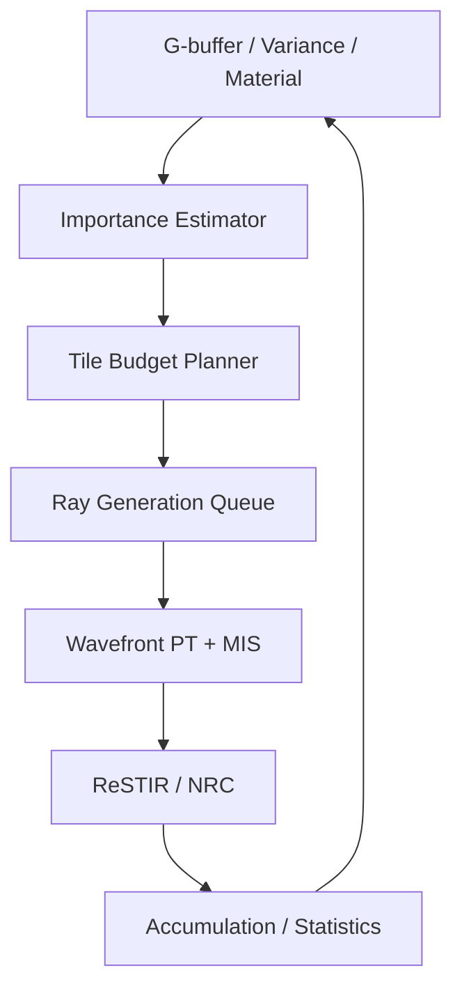

# Adaptive Sampling & Path Importance Scheduler — 独立開発計画書

**Version:** 0.1（設計・研究段階）  
**作成日:** 2026-11-04  
**対象:** Rust製GPUパストレーサーの独立モジュール。Vulkan共通基盤、将来的なOptiX/Metalバックエンドを想定。

> 画素単位の最小版（分散による停止）は M3 で実装済み（REQ-ACC-007、ADR-0015）。それ以外は未着手。
>
> 本書の高速化率は未測定。数式・優先順位は設計案であり、各アルゴリズムの統計的性質は実装ごとに検証する。

## 1. 目的と結論

**目的:** 限られたGPU時間・光線数を、画像品質改善に最も効く場所と経路へ配分する。主軸は**光の寄与度に基づくImportance Sampling / Path Reuse**。カメラ距離は画面空間のAdaptive Samplingにおける補助特徴量として使う。

### 役割分担

| レベル | 何を選ぶか | 主な信号 | 実装候補 |
|---|---|---|---|
| Pixel / Tile | どの画素に次のサンプルを割くか | 分散、推定誤差、距離、エッジ、材質、重要度 | Adaptive Sampling Scheduler |
| Light / Direction | どの光源・方向を重点的に引くか | BSDF、光源分布、Geometry、Visibility推定 | NEE、BSDF Importance、MIS |
| Path | どの光路候補を再利用するか | 候補の寄与、Proposal PDF、再利用重み | ReSTIR DI/GI/PT |
| Cache | どのRadiance推定を信用するか | 距離、法線、方向、Visibility、信頼度 | Spatial/Neural Radiance Cache |
| Device | 何にGPU時間を割くか | Kernel Time、Queue利用率、VRAM | Adaptive GPU Scheduler |

## 2. 先に区別する3種類の「距離」

1. **Camera Distance:** カメラと可視表面の距離。遠いだけでサンプルを減らすのは危険。面積、輝度、ノイズ、エッジ、反射の複雑さも必要。
2. **Light Distance:** 光源と照射点の距離。点光源などには逆二乗則が関わる。ただし面光源・環境光・遮蔽・BRDF・立体角により選択確率は異なる。
3. **Path Length / Cache Distance:** 光線の移動距離やキャッシュ点間距離。物理的な打ち切り・キャッシュ再利用を距離だけで決めると誤差を生みやすい。

**推奨:** Camera Distanceは「予算配分の弱い事前情報」、Light/Path Contributionは「サンプル方向の主要情報」。距離のみで光路を強制終了しない。

## 3. 統計的な基本設計

レンダリングは光輸送積分をモンテカルロ推定する。サンプル分布を変えても、適切な確率密度補正を行うことで不偏推定を保てる場合がある。

\[
I = \int_\Omega f(x)\,dx,\qquad
\widehat I = \frac{1}{N}\sum_{i=1}^N \frac{f(X_i)}{p(X_i)},\quad X_i\sim p.
\]

重要なのは大きい寄与を持つ経路が高い確率で選ばれるようProposal Distributionを改善すること。ReSTIRのような再利用には追加の条件・重みづけがあり、単に上式を適用すれば常に不偏になるわけではない。[S1][S2]

### Light / BSDF MIS

ベースラインはNext Event Estimation（光源サンプリング）とBSDFサンプリングをMISで合成する。光源サイズ、方向分布、遮蔽などに応じてサンプリングを最適化する。[S1]

### Path Reuse

ReSTIR DI → GI → PTを段階実装。空間・時間的に候補を再利用し、有望なサンプルを重点的に評価する。再投影、PDF、Jacobian、候補の重み、Reconnection、Visibilityを正しく扱う。[S2][S3]

## 4. Pixel-Level Adaptive Sampling

まず無条件の最小サンプル予算を確保し、画素・Tileごとの誤差を推定する。各画素への配分は単純な距離関数ではなく、複数の信号を統合する。

### 初期ヒューリスティック案

\[
s_p = a\,\widetilde V_p + b\,\widetilde E_p + c\,\widetilde M_p
      + d\,\widetilde P_p + e\,\widetilde D_p,
\]

ここで \(\widetilde V\) はノイズ/推定分散、\(\widetilde E\) はエッジ・Toon境界、\(\widetilde M\) は反射・屈折等の材質複雑度、\(\widetilde P\) は被写体/アーティスト優先度、\(\widetilde D\) は距離を元にした補助信号。それぞれ正規化・上限処理する。係数は未決定。

総追加予算 \(B\) に対して、例えば

\[
B_p = B\, \frac{\max(\epsilon,s_p)}{\sum_q\max(\epsilon,s_q)}
\]

を基にタイル単位の追加サンプル数を計画する。実際の整数丸めと未使用予算の再配分をSchedulerが処理。

**重要:** `D_p`だけで全予算を決めない。距離が遠くても鏡・細線・小さな光源・重要な背景はサンプルを要する。さらに、カメラ距離そのものより、スクリーン上のFootprint、Ray Differential、LODも有用。[S4][S5]

## 5. Distance-aware Radiance Cache

Radiance Cacheの近傍候補に距離減衰を使うのは合理的だが、位置が近いだけでは再利用できない。壁の裏表・遮蔽・法線差・鏡面材質では不正なブレンドになる。

例：

\[
w_i = \exp\left(-\frac{\|x-x_i\|^2}{2\sigma_x^2}\right)
      \cdot g_n(n,n_i)\cdot g_m(m,m_i)\cdot g_v(x,x_i),
\]

\(g_n\) はNormalの一致度、\(g_m\) はMaterial/BRDF適合性、\(g_v\) はVisibility/信頼度の評価。近似キャッシュではこれは物理的な厳密解を保証しない。

NRCの場合は学習済みRadianceを照会するだけでなく、Prediction ErrorやConfidenceを推定し、信頼度が低いときPhysical PTへ戻す。キャッシュの信頼度推定自体が研究対象。[S6]

## 6. Toon / Stylized PBRへの適用

- Toon Shadow Rampの境界はサンプリング優先度を上げる。
- Face-aware Shadingの影・ハイライト境界は時間的安定性を優先する。
- Outlineの線幅が1ピクセル付近の場所ではAliasingやDenoise破壊を検出。
- 単色で安定した背景は低い予算でもよいが、間接光や映り込みのためのサンプルは別扱い。
- アーティスト指定の重要領域（顔、製品、ロゴなど）は`Importance Mask`で指定できるようにする。
- `Reference`モードでは知覚重みや距離による明示的な画質妥協を無効化できる。

**注意:** Toonのシャープな段階影では分散が低く見えても閾値付近の誤差が目立つ。通常のBeauty分散だけを使わず、Shadow/Normal/Style AOVに由来するEdge Importanceを別信号にする。

## 7. GPUアーキテクチャ



### Buffer構成案

```rust
struct SamplingState {
    variance: GpuBuffer<f32>,
    importance: GpuBuffer<f32>,
    sample_count: GpuBuffer<u32>,
    depth: GpuBuffer<f32>,
    edge_mask: GpuBuffer<f32>,
    material_flags: GpuBuffer<u32>,
    tile_budget: GpuBuffer<u32>,
}
```

- `importance`と`variance`は反復ごとに更新するが、更新頻度はGPUコストで調整。
- 画素ごとの可変長Ray生成はGPU QueueへのAppend/Prefix Sumで処理。最初はTile単位予算の方が実装とDispatchが簡単。
- 最低サンプル数、Tileごとの最大値、時間的な変化の平滑化を設ける。
- Sampling StateとReSTIR Reservoir/NRC Cacheは明確に別リソースにする。
- Vulkan/Metal/OptiXで共通の意味論を使いつつ、DispatchとQueue実装はBackend固有にしてよい。

### Adaptive Integrator Interface（概念）

```rust
trait SamplingPolicy {
    fn configure(&mut self, config: SamplingConfig);
    fn schedule(&mut self, frame: &FrameStatistics, budget: GpuBudget)
        -> Result<SamplingPlan>;
}

struct SamplingPlan {
    min_spp: u32,
    additional_ray_budget: u64,
    policy_version: u64,
}
```

実際には`FrameStatistics`はGPUデータのハンドルと計測結果を含み、CPUへ全画素を同期コピーしない。`schedule`はGPU Compute Passの記録・依存関係生成へ落とす。

## 8. デバッグと検証

### 必須の可視化AOV

- Samples per Pixel / Tile
- Importance Heatmap
- Variance / Estimated Error
- Depth Weight
- Edge/Toon Weight
- ReSTIR Effective Sample Count / Reuse Validation
- NRC Confidence / Fallback Mask
- GPU Time by Pass

### 比較実験

1. 固定SPP + MIS/NEE（Baseline）
2. 分散のみAdaptive
3. 分散 + カメラ距離
4. 分散 + 距離 + Edge/Material
5. 上記 + ReSTIR DI
6. 上記 + ReSTIR PT / NRC（統合検証）

各ケースで**同じGPU時間**または**同じ画質誤差**にそろえて比較する。単なるSPPやレンダリング時間だけでは不公平。PSNR、FLIP、Temporal Flicker、重要領域の局所誤差、VRAM、GPU時間を記録する。Adaptive SamplingとDenoiseの統合を扱う研究も比較対象。[S7]

### テストシーン

- Cornell Box：基本GIと正確性。
- 多数の小光源：Direct Lightingの重要度分布。
- 鏡/ガラス：遠距離の高寄与経路・Caustics。
- 遠景に高周波テクスチャ：Distance-onlyの失敗検出。
- 壁の両側に異なる照明：空間キャッシュ漏れの検出。
- 動くキャラクターとToon Shadow：時間的安定性。
- 動くカメラとDisocclusion：履歴の破綻検出。

## 9. 実装優先順位

| Phase | 実装 | 完了条件 |
|---|---|---|
| A0 | 固定SPP、正しいMIS/NEE、GPUプロファイラ | Referenceとの品質一致と計測基盤 |
| A1 | 分散ベースAdaptive Sampling | 同画質到達時間がBaseline以下になるシーンを確認 |
| A2 | Tile Budget + Distance/Edge/Material Feature | Distance-onlyより安定していることを検証 |
| A3 | ReSTIR DI | 多光源シーンの効率改善、重み整合テスト |
| A4 | ReSTIR GI/PT | 難しい間接光での品質・性能・バイアス検証 |
| A5 | Distance-aware Cache + NRC Confidence | キャッシュ漏れを検出しFallback可能に |
| A6 | Learned Cost Model / Adaptive Integrator | GPU時間を含めた実測利益を確認 |

**最初のMVP:** A0〜A2。ReSTIRやNRCに進む前に、固定SPPとAdaptiveの公正な比較環境を完成させる。

## 10. 失敗パターン・安全策

| 失敗 | 原因 | 対策 |
|---|---|---|
| 遠景がぼける・ざらつく | Distance Weightが強すぎる | 距離寄与を制限、Footprint/Variance優先 |
| 鏡・ガラスにノイズが残る | 距離だけでは重要光路を判断不可 | Specular/Transmission専用Feature |
| シャープなToon影が壊れる | Denoise/分散指標が境界を無視 | Edge AOV、局所サンプル下限 |
| 壁の裏の照明が漏れる | 距離だけのCacheブレンド | Normal/Visibility/Material検証 |
| Adaptiveの方が遅い | スケジューリング/Compactionコスト | Tile化・Pass融合・更新頻度削減 |
| アニメーションがちらつく | 不安定な予算・履歴の再利用 | Temporal Smoothing、履歴無効化 |
| 統計的なバイアスが増える | 不適切な再利用重みや打ち切り | Reference/収束実験、PDF/Estimator検証 |

## 11. 主要参考資料

- **[S1] Physically Based Rendering, 4th ed. — System Overview:** https://www.pbr-book.org/4ed/Introduction/pbrt_System_Overview
- **[S2] NVIDIA RTXDI — ReSTIR PT:** https://github.com/NVIDIA-RTX/RTXDI/blob/main/Doc/RestirPT.md
- **[S3] NVIDIA Research — ReSTIR GI:** https://research.nvidia.com/publication/2021-06_restir-gi-path-resampling-real-time-path-tracing
- **[S4] Physically Based Rendering, 4th ed. — Ray Differentials:** https://www.pbr-book.org/4ed/Geometry_and_Transformations/Rays
- **[S5] Physically Based Rendering, 4th ed. — Texture Sampling & Antialiasing:** https://pbr-book.org/4ed/Textures_and_Materials/Texture_Sampling_and_Antialiasing
- **[S6] NVIDIA Research — Real-Time Neural Radiance Caching:** https://research.nvidia.com/labs/rtr/publication/muller2021nrc/
- **[S7] NVIDIA Research — Neural Temporal Adaptive Sampling and Denoising:** https://research.nvidia.com/publication/2020-05_neural-temporal-adaptive-sampling-and-denoising
- **[S8] NVIDIA Omniverse RTX Interactive Path Tracing:** https://docs-prod.omniverse.nvidia.com/materials-and-rendering/latest/rtx-renderer_pt.html
- **[S9] NVIDIA RTXPT — Design:** https://github.com/NVIDIA-RTX/RTXPT/blob/main/Docs/Design.md

## 12. 次の設計課題

1. GPU上のImportance/Variance Estimatorの数値安定性と更新式。
2. Tile Budget PlannerとQueue Compactionの具体的Dispatch設計。
3. Camera Distance以外のScreen-space Footprint計測。
4. ReSTIR Reservoirの契約とAdaptiveサンプル数の相互作用。
5. Stylized AOVとDenoiserの前後関係。
6. ベンチマーク用シーン、品質メトリクス、回帰テストの自動化。

