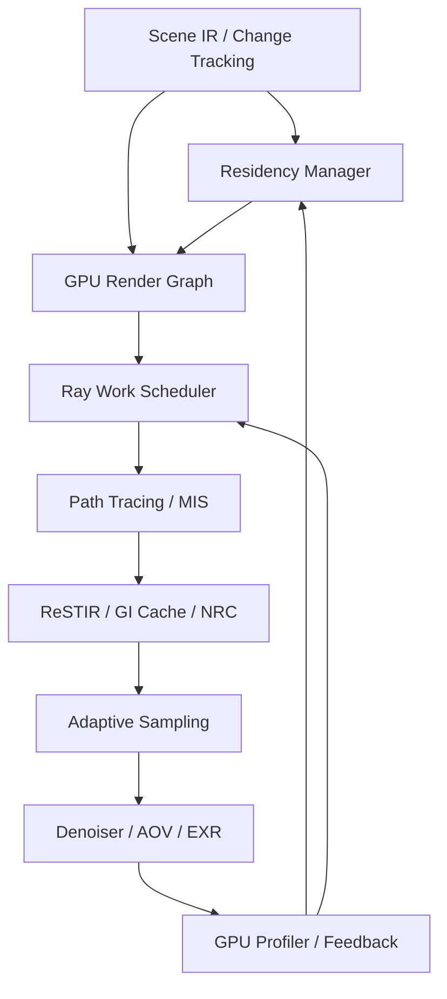
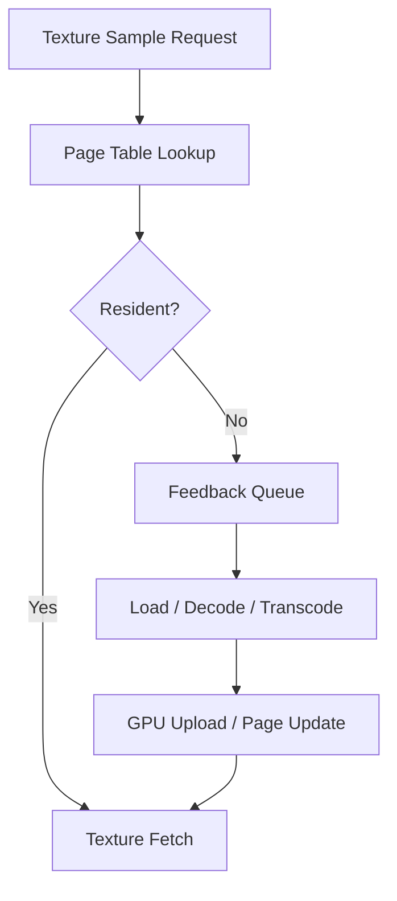

# Verion GPU Performance Architecture — 高速化・メモリ管理計画書

**Version:** 0.1（設計・研究段階）  
**作成日:** 2026-11-04  
**対象:** Verion — RustベースのGPU物理パストレーサー。Vulkan共通基盤、NVIDIA専用CUDA/OptiXパス、Apple Silicon Metalパスを想定。

> この資料はRedshiftの公開仕様を参考にしたVerion独自の設計案である。Redshiftの非公開実装を知っているという意味ではない。性能向上率は未計測であり、数値目標は仮説として扱う。

## 1. 目標と設計原則

**主要目標:** GPUの演算・メモリ・帯域を無駄なく使用し、同画質までの時間を短縮する。レンダリング対象がVRAMを超えても処理を継続し、可能なら性能低下を最小化する。

Verionの性能基盤を次の5層に分ける。

1. **GPU Work Efficiency:** Ray/Hit Queue、Wavefront/Megakernel切替、SER、Dispatch制御。
2. **Memory Residency:** VRAM予算、Texture Streaming、Geometry Streaming、Out-of-Core。
3. **Sampling Efficiency:** MIS、Adaptive Sampling、重要光路の選択、ReSTIR。
4. **Lighting Reuse:** GI Cache、ReSTIR、Neural Radiance Cache。
5. **Reconstruction:** Denoising、画像・時間方向の再利用、AOV品質保持。

## 2. Redshiftから確認できる設計上の教訓

| 領域 | Redshiftの公開仕様 | Verionへ取り込む教訓 |
|---|---|---|
| Unified Sampling | 画素のノイズを評価し、必要な場所へ追加サンプルを配分する。[S1] | 固定SPPをBaselineに誤差ベースの予算配分を構築 |
| Automatic Sampling | Adaptive Error Thresholdを中心に画素ごとのサンプル数を自動最適化。[S1][S2] | ユーザーが複数のサンプル数を調整しなくても品質を指定できるUI |
| GI Cache | Irradiance Cache/Point Cloudで一部のGI計算を再利用できる。[S3][S4] | GI品質に応じて物理PTと再利用の経路を選べる |
| Out-of-Core | Texture/GeometryがVRAMを超えても処理できる。必要なMIP/Tileを読み込む。[S5] | Cache ResidencyとI/OをRender Coreの正式機能にする |
| Ray Memory Budget | Ray・Geometry・Textureのメモリ配分がGPUバッチサイズへ影響。[S6] | バッファ予算を固定せずシーンの負荷から調整 |
| Hardware RT | レイトレーシング中心のシーンほどHW RTの恩恵を受けやすい。[S7] | HW RTの有無・GPU別の実測を比較 |
| Denoising | サンプルを減らす代わりに細部・正確性とのトレードオフ。[S8] | Time-to-Quality評価にDenoiserを含める |

**注意:** RedshiftがいつもOctane/Cyclesより速いとは限らない。シーン、サンプル品質、GPU、GIエンジン、Denoiserなどの設定による。現行Redshiftがすべてのシーンで上記のGI Cacheを使うという意味でもない。

## 3. 全体アーキテクチャ



Render GraphがGPUリソースの生存期間・バリア・Queue依存を管理し、Residency ManagerがどのリソースをVRAMへ置くかを管理する。双方が同じGPUメモリ予算を参照する。

## 4. GPU Memory Residency Manager

### 4.1 予算モデル

VRAM総容量のすべてをVerionの静的リソースへ割り当てない。OS、DCC、他アプリ、ドライバ、GPU一時領域を考慮して可変予算とする。

```rust
struct MemoryBudget {
    total_available: u64,
    geometry_target: u64,
    texture_target: u64,
    ray_queues_target: u64,
    frame_buffers_target: u64,
    cache_target: u64,
    scratch_reserve: u64,
}
```

**ポリシー:** VRAM Query、過去フレームのPeak、Scene Residency、Queue Occupancyから動的に予算を再配分。予算はHard LimitとSoft Targetを区別する。

### 4.2 Residencyの状態

| 状態 | 内容 |
|---|---|
| Resident | GPUローカルに存在し利用可能 |
| Pending Upload | CPU/ストレージから転送予約済み |
| Evictable | 参照されず追い出し可能 |
| Evicted | ホスト/ストレージ側に存在、GPU未常駐 |
| Pinned | 当該Pass/Frameで必要、追い出し禁止 |

GPU Passが利用するリソースは先にPinし、転送完了と必要なバリアが成立した後のみ利用。まだResidentでない場合、低LODの代替データを使うのはInteractiveモードに限定し、Final品質ではデータを待つ。

### 4.3 Eviction Policy

まずはLRU近似 + Streaming Priorityを採用。参照頻度、再取得コスト、サイズ、現在のFrameでの必要度を考慮する。CPU↔GPU転送が頻発するThrashingを検出した場合、Texture Budgetを増やす、Batchを調整する、同時作業量を減らす。

## 5. Virtual Texture / Texture Streaming

テクスチャ全体を常駐させず、Mip LevelとTile単位で必要な部分のみGPUへ供給する。Redshiftの公開資料でも、必要MIPやTileの読み込みとキャッシュ再利用が説明されている。[S5]

### パイプライン



**データ構造:** Virtual Page Table、Physical Tile Cache、Mip Pyramid、Feedback Buffer、Upload Queue、Resource Revision。Finalレンダリングでは欠けたページが画像の誤差にならないよう、再サンプリング・待機・バケット単位のデータ準備を設計する。

**初期設計候補:** 128×128または256×256相当の物理タイルを実験。サイズは決め打ちせず、GPUのSparse Image要件、テクスチャ圧縮Block、使用材質、I/Oバッチで評価する。

**必要な最適化:** Mip選択にRay Differential/Footprintを使用。Refraction/Reflection経由でも不適切な高Mip要求を減らす。[S9]

### Texture Processing Pipeline

- 事前にMipmap、Tile化、圧縮、色空間情報を生成してローカルキャッシュへ保存。
- キャッシュキーはソースHash、処理バージョン、ターゲットFormat、Color Space。
- データ読み込みとGPUアップロードをRender Passと重ねる。
- ソーステクスチャが変わったときだけ関係Tileを無効化。

## 6. Geometry / Acceleration Structure Streaming

Textureより難しい。Mesh/Instance、BLAS、TLASが相互に依存するため、Geometryを追い出すとTraceができなくなる。

**段階的戦略:**

1. **v1:** 全Geometry常駐、TextureだけOut-of-Core。
2. **v2:** Meshのコンパクトなホスト表現、GPU BLASの再構築/更新、BLAS Compaction。
3. **v3:** シーン空間・可視性・MaterialによるGeometry Residencyを検討。

Final品質では画面外のGeometryが鏡・影・GIに寄与する可能性がある。カメラFrustumだけで安全に追い出すことはできない。欠落し得るGeometryは保守的にResident保持、またはTraceを遅延して正しいデータを用意する。

VulkanのAcceleration Structureは明示的な構築・更新・同期が必要。[S10]

## 7. Ray Work Scheduler

### 7.1 Megakernel / Wavefrontの選択

- **Megakernel:** 小さなシーンや単純な材質でKernel/Queue管理コストを抑える。
- **Wavefront:** 複雑な材質と多数の光路を段階処理し、同種の計算をまとめる。
- **SER:** 対応GPUではRay/Shader実行の並べ替えを比較する。[S11]

両方式の最終結果を品質基準と照合し、GPU時間で切り替える。GPUごとに最適方式は異なる。

### 7.2 Queue構造（概念）

```rust
struct RayQueue {
    ray_ids: GpuBuffer<u32>,
    count: GpuBuffer<u32>,
    capacity: u32,
}

struct PathStateSoA {
    origins: GpuBuffer<Vec3>,
    directions: GpuBuffer<Vec3>,
    throughput: GpuBuffer<Vec3>,
    pixel_id: GpuBuffer<u32>,
    depth: GpuBuffer<u32>,
    rng: GpuBuffer<u32>,
}
```

実際のGPU LayoutはAlignment、Vector Padding、PrecisionをBackend別に定義する。Ray QueueとHit Queueは寿命を追跡し、未使用バッファ領域を次のPassで再利用する。

### 7.3 CapacityとBatching

- VRAMの残量から最大Active Pathsを算出。
- Camera RaysをTile/Batchへ分割。GPUが十分大きな仕事を持つようにしつつ、Queueの巨大化を避ける。
- GPU Indirect DispatchとCompactionでCPU待機を減らす。
- スレッド分岐、Register Pressure、Queue書込み競合をProfilerで評価。
- Batchを大きくするだけでは改善しない。OccupancyとMemory Residencyを同時に見る。

## 8. Sampling Efficiency / Denoising

### 基本階層

1. **Correct Baseline:** BSDF Importance、Light Importance、NEE、MIS、適切なRussian Roulette。
2. **Adaptive Sampling:** サンプル分散、エラー、Toon境界、Material複雑度に応じて画素予算を調整。
3. **ReSTIR DI → GI/PT:** 光路候補の空間的・時間的再利用。
4. **NRC:** 安定した間接光の一部を学習・推論で近似。
5. **Denoising:** 画質評価に含める。Denoiserが細部を消す場合、過度な低SPPを避ける。

この領域の詳細な数学・GPU予算割当は別紙`adaptive_sampling_scheduler_plan.md`に分離する。ここではメモリ・Kernel時間・品質への実際の影響を管理する。[S12][S13]

### GI方針

- Reference: 高品質な物理PTを基準にする。
- Production: ReSTIR等を導入。NRCを使う場合は信頼度・バイアス・費用を検証。
- Interactive: 積極的な再利用、Denoise、時間的蓄積を許容。

RedshiftのIrradiance Cacheが参考になる一方、低サンプルでは色むら・アニメーションちらつきが起こる可能性がある。[S3]

## 9. Stylized Renderingとの統合

Verionのコア要件はStylized PBR / Hybrid NPRも含む。効率化がToonの輪郭・影境界・髪ハイライトを壊さないことが重要。

- Material FeatureをQueue分類とSampling Weightへ供給。
- 顔、Shadow Ramp境界、Outlineは適応型サンプリングの優先度を上げる。
- DenoisingはBeautyだけでなくAlbedo/Normal/Style Edge AOVを参照。
- ReflectionやGIのキャッシュをスタイル変更時に再利用できるか、物理RadianceとArtistic Transformを分離して判断。
- Preview品質の低LODテクスチャでToon Rampや線幅が変わる場合、画面で分かるように表示。

## 10. GPU Metrics / 自動制御

各PassのGPU Timestamp、VRAM、Transfer Volume、Queue Depth、Missing Texture Page、Cache Hit Rate、Fallback Countを収集。

```rust
struct PerformanceMetrics {
    trace_ms: f32,
    shade_ms: f32,
    sampling_ms: f32,
    denoise_ms: f32,
    texture_upload_bytes: u64,
    residency_hit_rate: f32,
    ray_queue_peak: u32,
    vram_peak: u64,
}
```

**Adaptive Policy例:**

- Texture Cache Missが多い → Texture Budget増加、Batchを整理。
- Ray Queueが小さい → Batchを増やす（VRAMに余裕がある場合）。
- Ray Queueが大きすぎる → Batch縮小、Scratch再配分。
- NRC Trainingが利益を上回る → 更新間隔を延ばすか停止。
- GI Cacheの不確かさが高い → Physical PTへFallback。

Auto Tuningはまずログを記録してオフラインで最適値を見つける。ランタイム動的変更は品質差や振動を生み得るため、Hysteresisと最小更新間隔を設ける。

## 11. ベンチマーク設計

**同一GPU・Scene・Camera・解像度・色管理・比較可能な画質で比較すること。** Redshift/Octane側のDenoiser、Sampler、GPU RT設定を明示する。

| 指標 | 評価対象 |
|---|---|
| Time to Quality | PSNR/FLIP等の誤差閾値までの時間 |
| Total GPU Time | 各PassとUpload/Waitの内訳 |
| Peak VRAM | 常駐量とTransientのピーク |
| PCIe / Host Transfer | Upload総量、帯域、転送待ち |
| Texture Cache Hit | ページヒット率、Thrashing |
| Rays per Second | 光線処理吞吐、Queueごとの稼働率 |
| Temporal Stability | Flicker、Ghosting、GI Cache破綻 |
| Stylized Fidelity | Toon境界、顔影、輪郭の形状保持 |

### テストシーン群

1. Cornell Box：基礎GIとAccuracy。
2. 複雑なガラス/金属：長いSpecular Path、Memory Divergence。
3. 多光源インテリア：ReSTIR、Sampler。
4. 8K級Texture多数：Texture Page Streaming。
5. VRAM超過シーン：Out-of-CoreとThrashing。
6. 大量Instance / Animated Geometry：BLAS/TLAS更新。
7. Toon人物＋背景：顔影、Outline、Denoising。
8. Camera Pan / Animation：キャッシュ無効化・時間的一貫性。

各機能は**無効→有効のA/Bテスト**で測る。例えばTexture Streaming導入時は、VRAM内に収まるシーンでのオーバーヘッドと、VRAM超過シーンでの実用性を分けて評価する。

## 12. 実装ロードマップと受け入れ基準

| Phase | 実装内容 | 完了条件 |
|---|---|---|
| P0 | GPU Timestamp、VRAM、Queue/Upload Metrics | 再現可能なBenchmark Runner |
| P1 | Memory Budget Manager、Transient Alias、Queue Capacity | OOMを防ぎバッファ使用量を可視化 |
| P2 | Texture Preprocess、Mipmap、Page Cache、Residency | VRAM内外のTexture Sceneを正しく描画 |
| P3 | Asynchronous Texture Upload、Feedback、Eviction | Cache Thrashingを測定・抑制 |
| P4 | Megakernel/Wavefront A/B、Compaction、SER | GPU別の最適構成を測定 |
| P5 | Adaptive Sampling、Denoising、ReSTIR | 同画質到達時間を比較 |
| P6 | Geometry Residency / BLAS管理の高度化 | 大規模Sceneで正確性を維持 |
| P7 | NRC + 自動GPU Scheduler | 学習・推論コスト込みの利益を測定 |
| P8 | Vulkan / CUDA / Metal / OptiX比較 | Backend間の品質と速度を検証 |

**MVPはP0〜P2。** 初期のOut-of-CoreはTextureに限定し、GeometryをVRAM超過時に「欠けたまま描画する」ことは避ける。

## 13. リスク・設計判断

1. **Texture StreamingによるStall:** I/Oを隠せないSceneでは遅い。重要データの事前Prefetchが必要。
2. **Geometryの非可視判定:** 鏡・影・GIでは画面外も必要。Frustum Cullだけでは安全でない。
3. **Sparse Resourceの互換性:** Vulkan/Metalで機能・制約が異なるため共通Residency抽象とBackend固有実装を分ける。
4. **キャッシュと品質:** 近似GIやNRCにバイアス・時間的ちらつきがある。
5. **過度の自動最適化:** 設定の変更で品質が振動する。Referenceモードは自動近似を無効化できる。
6. **Denoiserによる細部欠落:** 見た目の滑らかさだけでなく高周波細部の保持を評価。
7. **ライセンス:** 使用SDKや圧縮ライブラリの配布条件を個別確認。
8. **競合製品比較:** Redshift/Octaneの内部実装の断定を避け、公開資料と実測で判断。

## 14. 参考資料

- **[S1] Maxon Redshift — Unified Sampling:** https://help.maxon.net/c4d/en-us/Content/_REDSHIFT_/html/Unified%2BSampling.html
- **[S2] Maxon Redshift — Sampling Production:** https://help.maxon.net/c4d/en-us/Content/html/VPRSRENDERER-REDSHIFT_RENDERER_TAB_SAMPLING.html
- **[S3] Maxon Redshift — Irradiance Cache GI:** https://help.maxon.net/c4d/en-us/Content/_REDSHIFT_/html/The%2BIrradiance%2BCache%2BGI%2BEngine.html
- **[S4] Maxon Redshift — GI Engines:** https://help.maxon.net/r3d/cinema/en-us/Content/html/GI%2BEngines.html
- **[S5] Maxon Redshift — Memory and Out-of-Core:** https://help.maxon.net/c4d/s26/en-us/Content/_REDSHIFT_/html/Memory.html
- **[S6] Maxon Redshift — System / GPU Memory Allocation:** https://help.maxon.net/c4d/en-us/Content/html/VPRSRENDERER-REDSHIFT_RENDERER_TAB_SYSTEM.html
- **[S7] Maxon Redshift — Hardware Ray Tracing:** https://help.maxon.net/c4d/2026/en-us/Content/html/VPRSRENDERER-REDSHIFT_RENDERER_TAB_SYSTEM.html
- **[S8] Maxon Redshift — Production Basic / Denoising:** https://help.maxon.net/c4d/en-us/Content/_REDSHIFT_/html/Render%2BSettings%2B-%2BBasic.html
- **[S9] PBRT 4th Edition — Texture Sampling and Antialiasing:** https://pbr-book.org/4ed/Textures_and_Materials/Texture_Sampling_and_Antialiasing
- **[S10] Khronos — Vulkan Acceleration Structures:** https://docs.vulkan.org/spec/latest/chapters/accelstructures.html
- **[S11] Khronos — Shader Execution Reordering:** https://www.khronos.org/blog/boosting-ray-tracing-performance-with-shader-execution-reordering-introducing-vk-ext-ray-tracing-invocation-reorder
- **[S12] NVIDIA RTXDI — ReSTIR PT:** https://github.com/NVIDIA-RTX/RTXDI/blob/main/Doc/RestirPT.md
- **[S13] Intel Open Image Denoise:** https://www.openimagedenoise.org/

## 15. 次の具体的な設計課題

1. `MemoryBudget`/`ResidencyManager`のRust TraitとGPU Backend境界。
2. Virtual Texture Page TableとTexture Feedback Format。
3. Tile Size/Mip選択、Texture Processing Cacheのファイル形式。
4. Render Graph内のUpload、Sparse Bind、Barrier、Pin/Unpin時点。
5. Ray Queue Capacity、メモリ計測、GPU Timestampの実装。
6. VRAM超過シーンの検証方法と正確性保証。
7. VerionとAerionが共有すべきTexture/Material Cache形式の設計。

